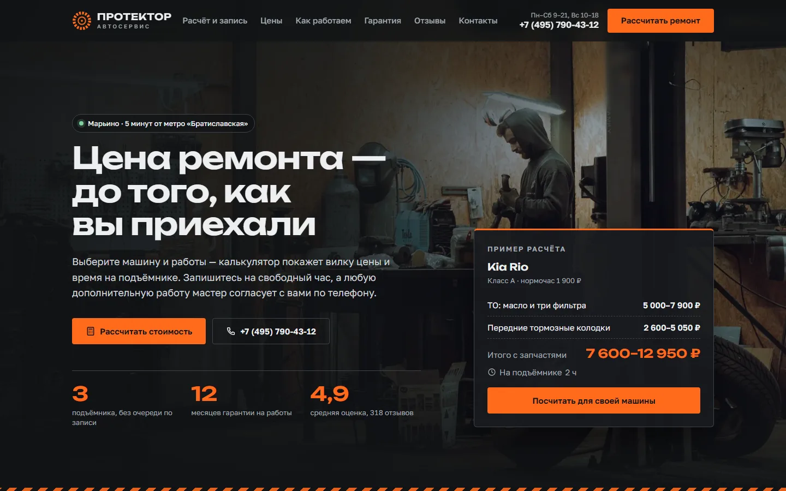
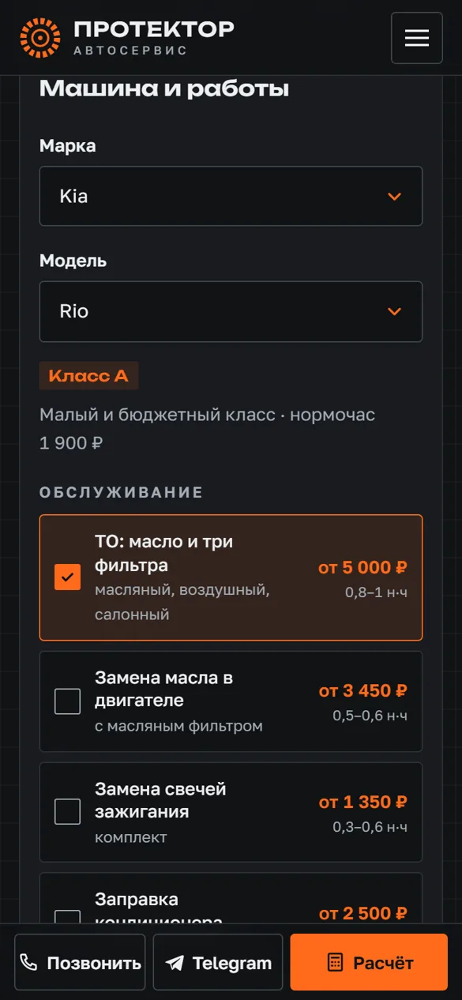

# Автосервис «Протектор» — демо-сайт

**Будущий адрес:** https://p4yla.github.io/protektor-autoservice/





Одностраничный сайт вымышленного независимого автосервиса на три подъёмника в Марьино (Москва). Главная задача сайта — водитель сразу видит примерную цену своего ремонта и записывается на свободное время, а заявка приходит мастеру-приёмщику в Telegram.

**Демо-проект для портфолио. Название, адрес, телефон, цены, реквизиты и отзывы вымышлены.**
Разработка: Анисимов П.Э., Telegram [@p4yLa](https://t.me/p4yLa).

## Что умеет сайт (для владельца сервиса)

- **Считает цену ремонта за минуту.** Клиент выбирает марку и модель (Lada, Kia, Hyundai, Skoda, VW, Toyota, Renault, Haval, Chery, Geely или «другая марка»), отмечает работы — и видит вилку «от–до», время на подъёмнике и разбивку по каждой работе. Можно выбрать «наши запчасти» или «привезу свои».
- **Записывает на свободное время.** Показывает только то время, когда освободится один из трёх подъёмников, с учётом длительности работ. Большой ремонт (например, ГРМ + сцепление) предлагает привезти к открытию и забрать на следующий день.
- **Не даёт записать двоих на одно место.** Если два человека одновременно выбрали последнее свободное время, запишется один, второму сайт предложит другое.
- **Присылает заявку приёмщику в Telegram:** машина, госномер, работы, оценка, время, пост, телефон и «что беспокоит».
- **Вызывает доверие:** правила работы (цена заранее, доп. работы только после звонка, старые запчасти отдаём, гарантия 12 месяцев), фото зоны ремонта, документы, отзывы, честный прайс по классам машин.
- **Удобен с телефона:** внизу экрана всегда кнопки «Позвонить», «Telegram», «Расчёт».
- **Готов к запуску в России:** согласие по 152-ФЗ, политика конфиденциальности, cookie-баннер, места под Яндекс Метрику и Вебмастер, без Google Fonts и внешних скриптов.

## Стек и структура

Чистые HTML, CSS и JavaScript, без фреймворков и сборщиков. Сайт открывается двойным кликом по `index.html`.

```
index.html          главная: все секции, SEO, JSON-LD (AutoRepair)
privacy.html        политика обработки ПДн (шаблон)
404.html            страница «не найдено»
css/style.css       переменные в начале файла, дальше mobile-first
js/catalog.js       СПРАВОЧНИК: марки, классы, нормочасы, запчасти, расписание постов.
                    Один файл и для сайта, и для сервера
js/main.js          меню, калькулятор и запись, прайс, отзывы, маски, cookie
tools/price-table.mjs  обновляет цены в HTML (для поисковиков и посетителей без JS)
img/                фото WebP в двух размерах, og.jpg, favicon.svg
fonts/              unbounded.woff2, golos.woff2 — только символы сайта (51 КБ на оба)
worker/             Cloudflare Worker: расписание (D1), запись, заявки в Telegram
docs/               скриншоты для README
netlify.toml, robots.txt, sitemap.xml
```

## Как считается цена

```
цена работы = нормочасы × ставка класса машины      (вилка: мин. и макс. нормочасы)
запчасти    = вилка «от–до» для класса              (0, если клиент везёт свои)
время       = сумма максимальных нормочасов, вверх до 30 минут
```

Ставки: класс A (Granta, Rio, Solaris, Logan…) — 1 900 ₽/н·ч, B (Octavia, Sportage, Jolion, RAV4…) — 2 300 ₽/н·ч, C (Camry, K5, Prado, Monjaro…) — 2 800 ₽/н·ч. Суммы округляются до 50 ₽.

### Справочник цен — как править

Всё в `js/catalog.js`:

- `CLASSES` — названия классов и стоимость нормочаса;
- `BRANDS` — марки и модели: `['rio', 'Rio', 'A']` = код, название, класс;
- `WORKS` — работы: `h` — нормочасы `[от, до]` для классов A, B, C; `p` — запчасти в рублях `[от, до]` (или `null`);
- `POSTS`, `HOURS` — подъёмники и часы работы по дням недели.

После правки:

```
node tools/price-table.mjs     # обновить цены в index.html (таблица и пример на первом экране)
cd worker && npx wrangler deploy   # сервер берёт тот же справочник
```

Калькулятор на сайте читает справочник сам, таблица без JS — после запуска `tools/price-table.mjs`.

## Расписание и заявки

```
сайт (GitHub Pages)
   │  GET /slots?brand=kia&model=rio&works=to,pads_f  — свободное время на 14 дней
   │  POST / booking    — запись
   │  POST / callback   — «перезвоните мне»
   ▼
Cloudflare Worker  protektor-booking   (worker/index.js + js/catalog.js)
   ├─► Cloudflare D1 «protektor» — таблица bookings (worker/schema.sql)
   └─► Telegram-бот → чат мастера-приёмщика
```

**Посты.** Клиент выбирает время приезда, сервер сам ставит машину на свободный подъёмник. Работа должна закончиться до закрытия (Пн–Сб 9–21, Вс 10–18). Сегодня можно записаться не раньше чем через час. Если работ больше, чем на рабочий день, единственный вариант — к открытию, пост занят на весь день.

**Защита от двойной записи.** Запись сохраняется одним SQL-запросом `INSERT ... WHERE NOT EXISTS (пересечение по посту и времени)`. SQLite выполняет его атомарно: из одновременных запросов на одно место пройдёт только один, остальные получат 409, и сайт вернёт посетителя к выбору времени.

**Цена считается на сервере.** Сайт отправляет только коды машины и работ. Сервер сам пересчитывает вилку и длительность по справочнику — подменить сумму в запросе нельзя.

**Демо-занятость.** В новой базе записей нет, поэтому часть времени на постах «занята» по формуле, а реальные записи ложатся поверх. Для настоящего сервиса поставьте `DEMO_BUSY = false` в `js/catalog.js`.

**Безопасность.** Токен бота — только в секретах Cloudflare. Заявки принимаются только с доменов из `ALLOWED_ORIGINS`, спам-боты отсеиваются полем-ловушкой, не больше 5 заявок с одного IP за 10 минут, госномер проверяется по формату, HTML в сообщениях экранируется.

Адрес функции задаётся в `js/main.js` в `LEAD_ENDPOINT`. Пустая строка — демо-режим: всё считается в браузере, заявки никуда не уходят.

### Команды

```
cd worker
npx wrangler d1 create protektor                                  # создать базу, id вставить в wrangler.toml
npx wrangler d1 execute protektor --remote --file=schema.sql      # создать таблицу
npx wrangler secret put BOT_TOKEN                                 # токен от @BotFather
npx wrangler secret put CHAT_ID                                   # ID чата приёмщика
npx wrangler deploy                                               # выложить функцию
npx wrangler d1 execute protektor --remote --command "SELECT * FROM bookings ORDER BY id DESC LIMIT 20"
```

## Перед запуском настоящего сайта

- Заменить название, адрес, телефон, часы, реквизиты, отзывы и цены на настоящие (`index.html`, `privacy.html`, `js/catalog.js`, `js/main.js` — `PHONE`, `ADDRESS`).
- Вписать ссылки на мессенджеры в `LINKS` в `js/main.js` (сейчас в демо по клику показывается подсказка).
- Заменить карточки документов «Образец» на настоящие сканы сертификатов.
- Адреса в canonical, og:url, og:image, JSON-LD, robots.txt и sitemap.xml указывают на GitHub Pages. При переезде на свой домен — заменить, а в 404.html убрать `<base href="/protektor-autoservice/">`. Новый домен добавить в `ALLOWED_ORIGINS` в `worker/index.js`.
- Выложить воркер, вписать его адрес в `LEAD_ENDPOINT`, выключить `DEMO_BUSY`.
- Раскомментировать Метрику и Вебмастер в `<head>`, согласовать текст политики с юристом.

## Фото

Бесплатные фото с [Unsplash](https://unsplash.com/license), обрезаны и сжаты в WebP (по два размера). Каждое просмотрено: без логотипов чужих автосервисов и читаемых номеров. На первом экране размыта наклейка на колонне подъёмника, на фото диагностики — логотип сервиса на толстовке.

| Файл | Автор | Unsplash ID |
|---|---|---|
| hero-*.webp, og.jpg | Kato Blackmore | KhF58h0hTbc |
| zone-diag | Sten Rademaker | UZUzvJEvKnI |
| zone-brakes | Erik Mclean | vS2shmNei2E |
| zone-service | Sasun Bughdaryan | 9gB7APNSquE |
| zone-engine | Christian Buehner | Fd6osyVbtG4 |
| zone-electric | Maxim Hopman | s4d_ESS0ylA |
| zone-tyres | Tuccera LLC | pi7Jlnh5nuY |
| zone-tools | Cecep Rahmat | CuW79v6t51U |

## Шрифты

[Unbounded](https://github.com/google/fonts/tree/main/ofl/unbounded) (заголовки, цифры) и [Golos Text](https://github.com/google/fonts/tree/main/ofl/golostext) (текст), лицензия SIL Open Font License. Взяты из репозитория google/fonts и ужаты пакетом [subset-font](https://www.npmjs.com/package/subset-font):

- `unbounded.woff2` — одна толщина 600, 26 КБ;
- `golos.woff2` — вариативный 400–600, 25 КБ.

В файлах только латиница, кириллица, цифры и знаки сайта (« » — № ₽ × · →). Если на сайте появится новый символ, пересоберите:

```js
import subsetFont from 'subset-font';
const woff2 = await subsetFont(fs.readFileSync('GolosText[wght].ttf'), 'все символы сайта…', {
  targetFormat: 'woff2', variationAxes: { wght: { min: 400, max: 600 } }
});
```

## Проверки и замеры

**Lighthouse 12**, мобильный профиль, 3 прогона, локальный сервер без сжатия (на GitHub Pages с gzip цифры обычно не хуже). Сдвиг вёрстки на главной — 0:

| | Performance | Accessibility | Best Practices | SEO |
|---|---|---|---|---|
| Главная | 97–98 | 100 | 100 | 100 |
| Политика | 100 | 100 | 100 | 100 |

**axe-core 4.10** (WCAG 2.1 A/AA + best practices) на 1440 и 390 px: главная, открытое меню, шаг выбора времени, шаг контактов с ошибками, политика, 404 — нарушений нет.

**Сценарии в браузере (Playwright, 1440 и 390 px):** меню и Esc, cookie, калькулятор на четырёх машинах разных классов — цена на экране совпадает со справочником, длинная работа, слоты, ошибки формы, маска телефона, госномер латиницей → кириллица, экран успеха, обратный звонок, переключатель класса в прайсе, статичная таблица цен = справочник. Ошибок в консоли нет, горизонтальной прокрутки на 390 px нет.

**Воркер:** `node --check`, сборка esbuild (как в wrangler) и тест на Node с базой SQLite вместо D1 — 1 565 проверок: цена сайта = цена сервера для всех 44 моделей и трёх «других» классов, независимая поминутная сверка свободных слотов, 6 одновременных запросов на одно время (записывается ровно столько, сколько свободных постов, остальным 409), пересечений записей нет, подмена цены, неверные дата/время, honeypot, лимит по IP, origin, длинные работы, экранирование в Telegram.
